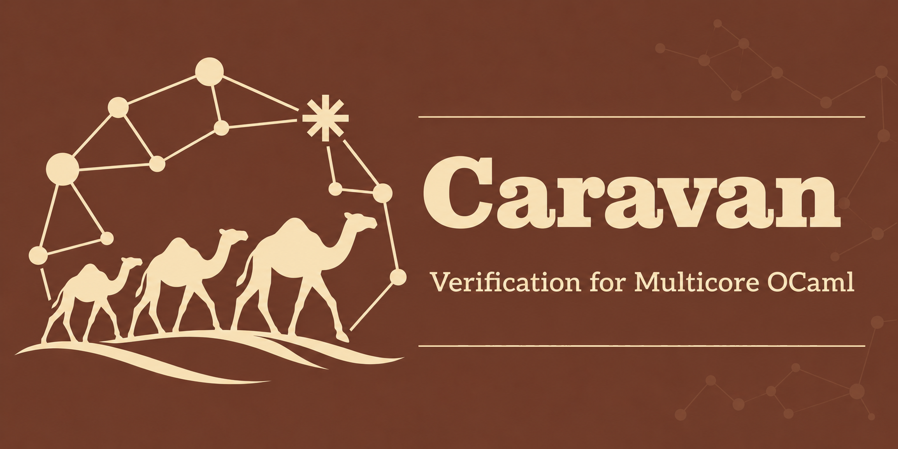

<p align="center">
  
</p>

<p align="center">
  <a href="https://raw.githubusercontent.com/nyu-acsys/caravan/main/LICENSE"></a>
  <a href="https://github.com/nyu-acsys/caravan/actions/workflows/ci.yml"></a>
</p>

Caravan verifies multicore OCaml programs. It translates OCaml 5 code, with
specifications written in comments, to [Raven](https://github.com/nyu-acsys/raven), an
SMT-based verifier for concurrent separation logic, and reports what Raven finds in terms
of the OCaml source.

Caravan is at an early stage of development: so far, it verifies first-order functions on integers, booleans, tuples, lists, options, variant types, mutable records, references and atomics, with loops, predicates and logically atomic contracts. Specifications go in `(*@ ... *)` comments in the `.ml` or its `.mli`, and predicate definitions in the `.ml` or a `.proof` file next to it.

When a sibling `.mli` exists, Caravan uses OCaml's signature-inclusion checker to
validate the implementation against it before verification. Abstract interface
types, private implementation bindings, and monomorphic interface specializations
of polymorphic implementations are supported.

Functions and monomorphic types can be grouped in `module ... = struct ... end`,
including nested modules. Calls and annotations resolve names in their enclosing
OCaml scope. Plain module aliases retain the original types and ownership predicates.
Named signatures and `.mli` files restrict the members available to callers;
place exported function contracts in the signature. Private function bodies are
also verified.

Static source modules can have mirrored blocks in their companion `.proof` file,
containing logical types and functions, resource-algebra instances, ghost fields,
predicates, invariants and lemmas. Proofs can use private implementation types.
Module signatures expose abstract resource contracts while hiding their definitions
and implementation lemmas. Aliases preserve resource identity. AU facades can be
scoped to source modules, with qualified operation and token names. State records,
views and actions also support static module scopes. Supported named single-parameter
functors can contain predicates and lemmas used by manual scopes and clients of
applied result modules; these proofs are verified once in a shared Raven functor.
Aliases preserve proof member identity, while result signatures expose declared
predicates opaquely and hide implementation lemmas. Other functor-owned proof
declarations are not supported yet.

A client in the same source file uses the module's concrete type encoding.
Clients verified against interface-only dependencies use abstract types instead.

Imported interfaces can expose nested modules with ordinary or logically atomic
contracts. The module client in
[`test/examples/module_stack_drain`](test/examples/module_stack_drain)
uses these contracts through an alias of the stack module.

Recursive and local modules, `open`, `include`, and module
initialization expressions are not supported yet. Specification calls through
constrained module signatures, nested implementation predicates, and shared-state
declarations remain outside this module support.

Interface-only dependencies found locally or through `-I` expose assumed contracts
to clients, including logically atomic contracts. For example:

```ocaml
type t
(*@ invariant shared (cell : t) *)
(*@ predicate contents (cell : t) (value : int) *)

val read : t -> int
(*@ result = atomic read cell
    requires shared cell
    atomic requires contents cell value
    atomic ensures contents cell value && result = value *)
```

An interface `invariant` declares a duplicable resource whose definition uses
`invariant` in the implementation's `.proof` file. A `predicate` declares an
ordinary resource predicate. Imported contracts retain ordinary and atomic
clauses separately; Raven checks ownership and invariant restoration at calls.
Their implementations must be verified separately against the same interface.
A logically atomic contract does not declare a physically atomic operation.

Module types can declare abstract resources using the same annotation forms. A
constrained alias checks the actual operations against the requested contracts:

```ocaml
module type READER = sig
  type t
  (*@ invariant shared (cell : t) *)
  (*@ predicate contents (cell : t) (value : int) *)

  val read : t -> int
  (*@ result = atomic read cell
      requires shared cell
      atomic requires contents cell value && value >= 0
      atomic ensures contents cell value && result >= 0 *)
end

module Checked : READER = Cell
```

Given the preceding `Cell` interface, this view requires nonnegative contents and
promises a nonnegative result. The original contract remains available through
`Cell`; callers through `Checked` use the requested contract. Both paths refer to
the same resources, while source-visible type equalities follow OCaml's ascription.
Raven checks the forwarding proof, including restoration when an atomic call aborts.

Checked bindings currently support first-order functions with matching operation
kinds, resource parameter modes, and concrete and inferred-state argument shapes.
Explicit ghost adaptations, public AU tokens, non-function values, nested module
members, and resource definitions in signatures are unsupported. An already checked
view cannot yet be constrained again by a callable signature in its enclosing
`.mli`; use named checked bindings for successive views.

Monomorphic functors with named module parameters and a structure body support
concrete path applications such as `module Client = Drain (Treiber_stack)`.
Curried applications and partial applications such as `module With_A = Make (A)`
and `module Client = With_A (B)` preserve the same result types as `Make (A) (B)`.
Each application checks the complete argument against the parameter signature.
Eligible bodies share one generic proof across applications, including parameters
with invariant resources. Manual proofs and other unsupported generic encodings
retain separate verified specializations. Parameter calls use the signature's
contracts, including its abstract resources and logically atomic clauses. Captured
names retain their definition-time scope. Unused functor bodies are not verified.
Result variants and records share their types and mutable fields across repeated
applications to the same module, including aliases. Distinct argument modules
retain distinct result types.
Unit functors such as `module Make () = ...` are also supported: separate
`Make ()` applications have fresh nominal result types and mutable fields, while aliases
of one result share its identity.
See the separate
[`functor_stack_drain`](test/examples/functor_stack_drain) example.

Type aliases in results are supported; higher-order or
imported functors, anonymous arguments, nested parameter
modules, and shared-state initializers inside functors remain unsupported.

Proof files also support checked lemmas and monomorphic logical variant types.
A lemma has typed parameters and an expression body after `=`. Optional
`returns`, `requires`, and `ensures` clauses state its contract explicitly.
Recursive lemmas require a `variant`, which can be a list for structural
induction. Bindings in the body are immutable and lexical:
`let (value : int) = expression in body`.
Write each clause with its full expression in parentheses, for example
`requires (p x)`, `ensures (result = x)`, and `variant (xs)`.
The final expression supplies the result, or a tuple for multiple `returns`
parameters; a lemma without results ends in a unit expression such as `()`.
Bodies can call other lemmas, use `if` and `match`, and check `assert` expressions.
As in OCaml, `assert false` can finish an unreachable branch of any result type;
the assertion must still be proved. All lemma bodies are verified.

Trailing lemma parameters can carry `[@implicit]` attributes:

```ocaml
lemma preserve (cell : int Atomic.t) (value [@implicit] : int)
  requires (own cell value)
  ensures (own cell value) =
  ()
```

Calling `preserve cell` lets Raven infer `value` from the visible ownership.
`preserve cell 7` supplies it explicitly. With several implicit parameters,
callers may supply an initial part of that suffix and leave the rest inferred.
All explicit parameters must precede implicit ones. Supplied arguments are
checked against their OCaml types before translation. Inference uses Raven's
existing witness computation; values hidden inside predicates or not determined
by available resources may need explicit arguments.

Ordinary predicates use the same attribute for implicit output parameters,
including values containing references:

```ocaml
predicate held (cell : int Atomic.t Atomic.t)
    (value [@implicit] : int Atomic.t) =
  own cell value
```

Write `held cell` to omit the output, or `held cell value` to specify it.
The same choice is available in `fold` and `unfold`, and callers can supply an
initial part of a longer output suffix. Raven checks that simultaneously owned
instances with the same explicit arguments agree on their outputs. It can then
infer lemma arguments from an owned predicate instance. Constructing or refolding
an instance may still require explicit output values.

Declarations and definitions must agree on the output parameters. Unannotated
predicates retain the existing convention of treating trailing parameters that
contain no references as outputs. Explicit output attributes apply to ordinary
predicates; invariants retain their existing parameter handling.

An annotation `(*@ lemma lemma_name args *)` calls a checked lemma from
program code. In a proof body, `unfold p x {n}` names an existential to bind
with `let value = ... in`, and `fold p x {n = value}` supplies its
witness. Unfold bindings infer their types from the named existential declarations;
explicit type annotations remain optional. Use `fold p x` when no explicit witness
is needed.

Specification types include `'a finset`, `'a set`, and `('k, 'v) map` when those
names are not already declared by the program. `Finset` and `Set` provide
`empty`, `singleton`, `mem`, `union`, `inter`, `diff`, and `subset`; `Finset`
also provides `choose`, whose set must be nonempty. Maps use `Map.const`,
`Map.get`, and `Map.set`. A constant map may need an explicit type annotation,
such as `(Map.const 0 : (int, int) map)`.

Specifications also provide `'a sequence` with indexing, `length`, `last`, `drop`,
`take`, and concatenation using `++`. `to_sequence xs` converts an OCaml list to a
logical sequence, preserving order and length. It uses Raven's checked `Seq.of_list`
laws and is unavailable in executable OCaml. Reference element types are checked
before translation; for example, an `int ref list` converts to `int ref sequence`.
An existing function or local binding named `to_sequence` keeps its own meaning.

Use the specification-only type `integer` for unbounded mathematical indices and
arithmetic. Quantifiers over `int` retain OCaml's machine bounds; quantifiers over
`integer` range over all integers. The type is introduced only if the program has
not declared its own `integer`, and is unavailable in executable OCaml.

An automatic constructor can recover ghost values through checked lemma calls
before establishing its initial shared state:

```ocaml
(*@ initially
  let cell_list = expose_built_chain (Some q.head) tail_ list in
  { cells = to_sequence cell_list;
    values = to_sequence list;
    head = 0;
    tail = List.length list } *)
```

Initializer bindings are local to that annotation. They execute after the runtime
result is available and before the initial views, history, and invariant are
established. The helpers must prove the required ownership and state facts.
For a dynamic sequence owned by index, Caravan derives the index map through a
checked helper requiring distinct entries; literal initializers retain their
existing translation. Unknown, duplicate, and missing state fields are rejected.

Equality in specifications distinguishes OCaml comparisons from logical equality:

| Operators | Meaning |
|---|---|
| `=`, `<>` | Structural equality and inequality on runtime values without references or mutable records; mathematical equality on logical types, sets, and maps. |
| `==`, `!=` | Physical identity on references, atomics, and mutable records; exact comparison on immediate values. Boxed physical comparisons are rejected in specifications. |
| `===`, `=/=` | Logical equality and inequality: compare immutable structure recursively and heap references by identity, without reading their contents. |

The specification-only operators `===` and `=/=` translate directly to Raven's
`=` and `!=`. For example, `[left] === [right]` compares the identities of the
references in the lists. Ordinary OCaml structural equality on runtime values
containing references or mutable records is rejected in both code and
specifications. Tests against nullary constructors, such as `cells = []`, remain
supported.

Ordinary reference and mutable-record accesses require ownership and translate
to procedures with ordinary contracts. Reads accept a positive fractional share;
writes require full ownership. Raven consequently rejects these accesses while a
shared invariant or atomic update is open. `Atomic` operations retain their
atomic contracts.

Proof files can define nonrecursive pure logical functions with typed parameters
and results. A set comprehension uses an OCaml-style binder:

```ocaml
let single (value : int) : int set =
  Set.of_predicate (fun (candidate : int) -> candidate = value)
```

Logical definitions can call previously declared logical functions and use
`let`, `if`, and `match`; they cannot read heap ownership or call predicates.
OCaml checks their bodies and arguments before translation, including reference
element types. Matches must be exhaustive.

Named instances of `SetRA` and `Auth` expose Raven's resource algebras:

```ocaml
type fact = Seen of int
module Facts = SetRA (struct type t = fact end)
module Authority = Auth (Facts)

let facts : (int Atomic.t, Authority.t) Ghost.field = Ghost.field ()
```

Each instance has a distinct resource type. Resource operations are qualified,
such as `Facts.set`, `Authority.auth`, `Authority.frag`, `Authority.auth_frag`,
and `Authority.full`. These declarations support these library instances.

`Ghost.at facts cell` names a ghost location attached to an owner of the declared
type. Use it through `own`, for example
`own (Ghost.at facts cell) (Authority.auth (Facts.set known))`.
Qualified descriptors such as `Ghost.at Counter.facts cell` follow module aliases
and visibility. `Auth (Counter.Facts)` can likewise use a qualified resource module.
Declaring a field grants no ownership and performs no allocation. In a lemma
body, `Ghost.fpu location before after` checks a frame-preserving resource update,
consuming ownership of `before` and producing ownership of `after`. It must preserve
compatibility with resources held by other threads. Resource fields do not support
ordinary assignment.

Ghost fields can also store ordinary values, such as `int list` or `bool`.
Ownership defaults to a full share; write
`own ~fraction:Permission.half (Ghost.at contents cell) values` for half ownership.
`Permission.full` names a full share. In checked proof bodies,
`Ghost.read (Ghost.at contents cell)` requires a positive share, and
`Ghost.write (Ghost.at contents cell) values` requires full ownership.
Resource fields use `Ghost.fpu` instead of these reads and writes.

Initialize explicit ghost fields on fresh concrete allocations:

```ocaml
let cell = Atomic.make 0
(*@ initializes [
  Ghost.init contents [];
  Ghost.init facts (Authority.full (Facts.set Set.empty))
] *)
in
cell
```

Each descriptor's owner type must match the allocated reference, and its value
must have the declared field type. Initializers belong to the same allocation as
the concrete fields; they cannot attach to an existing reference or a call to a
constructor function. The supported allocation sites are `ref`, `Atomic.make`,
`Atomic.make_contended`, and fresh mutable records. A field can occur only once
in the initializer list. Explicit fields are independent of generated state,
histories, and action proofs.

Checked proof bodies can allocate a fresh opaque `Ghost.t` reference using
`Ghost.alloc [Ghost.init linked false; Ghost.init retired false]`, where both
field descriptors have owner type `Ghost.t`. These allocations and all ghost
storage operations are erased from the OCaml program. Field reads and
allocations are proof operations; pure logical definitions cannot perform them.
`Ghost` and `Permission` are reserved module names.

Direct invariants use the same declaration syntax as state-based invariants:

```ocaml
invariant live (cell : int Atomic.t) =
  exists value : int. own cell value
```

When the final parameter names a ghost state record declared in the proof, Caravan
elaborates the existing state-based form with its generated support. Otherwise,
all parameters are invariant inputs and the body is emitted directly, without
state, history, or action synthesis.

State records, stateful invariants, views and actions can appear in mirrored static
module blocks. State field types use their declaration's environment. Views and
actions belong to a stateful invariant in the same proof scope: parameter types and
state binders identify the invariant, and ambiguous matches are rejected. Signatures
export the invariant and view contracts while hiding their state representation and
actions. Aliases retain their identities; sibling modules can reuse proof names.

A `(*@ manual *)` annotation after a function selects a checked manual proof.
The function keeps its OCaml implementation and contract; its proof supplies
invariant opening and closing. Local functions inherit the enclosing manual
mode. A `(*@ proof ... *)` block uses the same expression language as checked
lemmas, including lexical bindings and fold/unfold witnesses. Block-local names
do not escape into the runtime program.

Proof blocks can use parameter names from the contract when those names do not
shadow OCaml bindings. This also names the implicit argument of `function` syntax;
ordinary OCaml bindings retain their lexical precedence.

An access annotation attaches a proof closure to one `Atomic` operation or
runtime call:

```ocaml
let read (cell : int Atomic.t) = Atomic.get cell
(*@ Ghost.scope (fun step ->
  let state = unfold live cell {value} in
  let observed = step () in
  fold live cell {value = state};
  observed)
*)
(*@ manual *)
(*@ result = read cell requires live cell ensures live cell *)
```

The operation and result names are freely chosen lexical bindings. Ghost values
bound before the operation remain in scope afterward. The closure must contain
one unconditional `let` binding of the supplied operation applied to its ghost
input bundle (`()` for an `Atomic` operation), and
end with that binding's unchanged result. Preparation and restoration use
checked ghost expressions. The operation cannot escape, be duplicated, or run
conditionally. Nested accesses have their own annotations; original arguments
are evaluated before their access proof in OCaml order.

`Ghost.State.scope` carries a ghost value between access annotations in the
same lexical sequence. Its first scope receives `()`; each later scope receives
the previous scope's output, which may have a different type:

```ocaml
let first = Atomic.get cell
  (*@ Ghost.State.scope (fun step () ->
    let result = step () in
    (result, result)) *)
in
Atomic.get cell
(*@ Ghost.State.scope (fun step (known : int) ->
  let result = step () in
  assert (result = known);
  (result, known)) *)
```

The pair returned by a state scope contains the unchanged runtime result and
the next ghost value. State scopes attach to a direct right-hand side, the left
side of a sequence, or a tail expression. The state binder may be `()`, a
variable, a tuple, `_`, or a typed pattern. Branches, matches, loop bodies, and
nested right-hand sides inherit the enclosing state; changes inside those
regions do not escape. Thus branches may produce different ghost value types,
and a loop does not carry ghost state between iterations. A loop invariant can
refer to its inherited state with `invariant (fun saved -> proposition)`.
Ordinary `Ghost.scope` annotations and unannotated expressions preserve the
current ghost state.

Calls with ghost parameters use an access scope around the runtime call. The
scope's operation accepts one ghost input bundle: `()` for none, the value for
one, or a tuple for several. The runtime callee and its ordinary arguments are
evaluated once. A callee with ghost results supplies them through
`Ghost.returns` on a normal tail expression:

```ocaml
let read_known (cell : int Atomic.t) = Atomic.get cell
(*@ Ghost.scope (fun step ->
  let result = step () in
  result) *)
(*@ Ghost.returns (fun result () -> result) *)
(*@ manual *)
(*@ result, [seen : int] = read_known [expected : int] cell
    requires own cell expected
    ensures own cell expected && result = seen && seen = expected *)

let use_known cell = read_known cell
(*@ Ghost.scope (fun invoke ->
  let (result, seen) = invoke 7 in
  result) *)
(*@ manual *)
(*@ result = use_known cell
    requires own cell 7
    ensures own cell 7 && result = 7 *)
```

The return adapter receives the runtime result and the current lexical state;
its proof expression supplies the declared ghost results. Every runtime return
path must provide one adapter when the contract declares ghost results. With no
ghost results, invoking the call yields the ordinary runtime result. With one
or more ghost results, it yields `(runtime_result, ghost_results)`, where
multiple ghost results form a tuple. A stateful call scope can pass its current
state as the ghost input and return a new state after the call.

Manual and automatic proofs share runtime translation, primitive implementations,
and ghost-expression lowering. Raven checks permissions, invariant closure,
atomicity, and contracts; Caravan checks the annotation shape that preserves the
runtime operation. Manual mode supplies its own invariant proof steps and rejects
automatic `commit`, `returning`, and `performs` annotations.

Manual atomic proofs declare a typed facade in the companion `.proof` file:

```ocaml
module Read = Ghost.AU (struct let operation = read end)
```

`Read.token` identifies updates for that procedure. In a proof expression,
`Read.bind ()` returns the current call's token; repeated binds return the same
value. `Read.access token cell` opens the atomic precondition and returns its
implicit parameters, with inferred types. Multiple implicit parameters form a tuple
in name order. `Read.abort token cell` restores the
precondition; `Read.commit token cell result` establishes the atomic postcondition.
Each operation takes the procedure's concrete arguments in their declared order,
including unit arguments, followed by its declared ghost inputs. `commit` and
`committed` then take the runtime result followed by each declared ghost result.
For example, an operation with one ghost input and output uses
`Read.access token cell expected` and
`Read.commit token cell expected result seen`. A unit runtime result is still
passed as `()`, separately from any unit-valued ghost result.

For example, with `contents cell value` defined as `own cell value`:

```ocaml
let read (cell : int Atomic.t) = Atomic.get cell
(*@ Ghost.scope (fun step ->
  let token = Read.bind () in
  let value = Read.access token cell in
  unfold contents cell value;
  let observed = step () in
  fold contents cell value;
  Read.commit token cell observed;
  observed)
*)
(*@ manual *)
(*@ result = atomic read cell
    atomic requires contents cell value
    atomic ensures contents cell value && result = value *)
```

`Read.pending token cell` and `Read.committed token cell result` describe the
corresponding AU resources in predicates and lemma contracts. Tokens can be stored
in ordinary ghost fields and passed to checked lemmas, allowing a helper to open
and commit a registered operation. Raven checks the resource and atomicity rules;
Caravan preserves the procedure-specific token types before translation.
AU facades name procedures in the same implementation.

Read-modify-write primitives use Raven's `atomic proc` declarations with ordinary
contracts. Each call executes as one physical step, so an access scope can expose
a segment with a checked lemma before a generic CAS and reassemble it afterward,
without a separate abort-restoration proof at that primitive call.

The [List/segment Michael–Scott queue](test/saturn/michael_scott_queue_lseg/)
combines these features in a complete manual proof. Its FIFO contracts cover
`create`, `of_list`, `push`, `pop_opt`, and `is_empty`, including the empty-check
helping protocol; the recursive enqueue/tail helpers are also checked.
The proof uses algebraic lists, heap segments, and monotone fact snapshots.
It retains explicit witnesses and resource updates as a reference for future
automation. The original sequence/history queue remains a separate case study in
[test/saturn/michael_scott_queue/](test/saturn/michael_scott_queue/).
The [module-wrapped history queue](test/examples/module_ms_queue/) reuses that
implementation and proof behind a static signature, with clients through an alias.

The additional `swing_tail` operation has no Saturn counterpart. Its history and
segment proofs live in the separate [queue tail advancement example](test/examples/queue_tail_advance/),
which reuses the queue implementations and proof definitions.

The [stack drain client](test/saturn/stack_drain/) adapts Saturn's tutorial to
our Treiber stack interface. Its contract says that draining a stack containing
`xs` returns `xs` and leaves the stack empty. It needs no inline proof annotations
or companion proof file. The regression verifies both the stack implementation
and the client against the same interface, with the representation hidden from
the client.

## Building

Caravan needs OCaml 5.5 and the library `raven-ivl.api` of Raven, which is not on opam yet.
Install it from Raven's `dev` branch:

```
$ opam switch create caravan 5.5.0
$ eval $(opam env)
$ opam pin add raven-ivl git+https://github.com/nyu-acsys/raven.git#dev
$ opam install . --deps-only --with-test
$ dune build; dune runtest
```

To build against a checkout of Raven instead, link it as `vendor/raven`:

```
$ ln -s ../../raven vendor/raven
```

Raven runs [Z3](https://github.com/Z3Prover/z3) (>= 4.13.0), which has to be on the path.

See [test organization](test/README.md) for the distinction between focused
regressions, verification examples, Saturn studies, and independent case studies.
