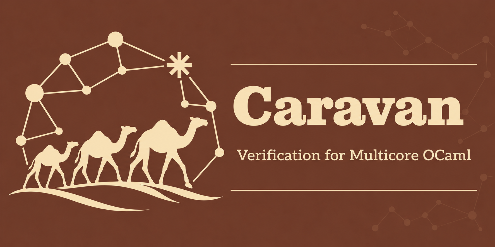

<p align="center">
  
</p>

VS Code integration for [Caravan](https://github.com/nyu-acsys/caravan), an SMT-based
verifier for multicore OCaml programs using concurrent separation logic.

New to Caravan? Start with the **[project introduction and examples](https://github.com/nyu-acsys/caravan#readme)**.

## Features

- **Syntax highlighting** for `(*@ ... *)` specifications and `.proof` files.
- **Verification on save**, with manual verification from the Command Palette.
- **Diagnostics** in the editor and Problems panel, with gutter markers for errors,
  warnings, and related locations in companion files.
- **Contract hovers** on function names, showing contracts from `.mli` and `.proof`
  files with syntax highlighting and links to their sources.
- **Proof hints** showing external proof steps beside the implementation, with
  full annotations on hover and navigation to their sources.
- **Read-only proof views** combining an implementation with its external annotations.
- **Generated Raven views** showing the translated program in a read-only editor.
- **Verification status** above members, modules, and functors, updated as checks
  finish and indicating when successful results came from the cache.

## Prerequisites and installation

Install **Caravan** from VS Code's Extensions view, or install a downloaded VSIX
with **Extensions: Install from VSIX**. Platform packages bundle Caravan, its
linked Raven verifier, Z3, and matching OCaml standard-library interfaces for
Linux x64, macOS arm64, and Windows x64. No separate verifier installation is
needed for self-contained programs.

The extension requires [OCaml Platform](https://marketplace.visualstudio.com/items?itemName=ocamllabs.ocaml-platform)
for OCaml editing, completion, navigation, formatting, and base syntax highlighting.
Caravan adds specification and proof support alongside it.

For other platforms, install [Caravan and its dependencies](https://github.com/nyu-acsys/caravan#building)
and configure `caravan.executable`.

## Usage

Open an annotated `.ml` file, its `.mli`, or its `.proof` file in a trusted workspace.
Save to verify, or run **Caravan: Verify Saved File** from the Command Palette.
Clicking the **Caravan:** status bar item also verifies the active file.
For an interface or proof file, Caravan verifies the sibling `.ml` implementation
with its companions.

Verification uses saved files. Save changes to the implementation and its
companions before checking; opening a file alone does not run verification.
Editing a file marks its previous result outdated and stops obsolete checks.

### Reading contracts and proofs

Hover over a function name to see its external contract, with a link to the
original `.mli` or `.proof` source. Short inline hints show proof steps at their
attachment points; hover for the full annotation or follow the source link to edit
it. Enable `editor.inlayHints.enabled` to see these hints.

Run **Caravan: Show Proof View** to open a read-only view beside the implementation.
It combines the code with external contracts and proof steps and includes the full
companion files. Follow its source links to edit the originals. Contract hovers,
proof hints, and proof views are available without running the solver.

Run **Caravan: Show Generated Raven** to open the saved implementation's translated
Raven program in a read-only tab beside the source. This command also works from
its `.mli` or `.proof` file. It translates without running SMT verification and
uses the same toolchain and project settings as verification. The view refreshes
when sources, dependencies, or settings change; save dirty files to see their
updated translation. Syntax highlighting is provided by the optional
[Raven Verifier extension](https://marketplace.visualstudio.com/items?itemName=nyu-acsys.raven-verifier);
without it, the view is plain text.

### Verification results

Member status lenses start as `○ not checked`. During verification they show
`⋯ checking`, then `✓ verified`, `✗ failed`, `⏱ timed out`, or `– skipped`.
`○ type-checked` records front-end checking, and `– trusted` identifies assumed
contracts. A `(cached)` label means all proof checks for that member were reused.
Module and functor summaries collect their members' results.

Errors and warnings appear in the editor and Problems panel. Gutter icons also
mark related locations, including in companion files; hover over them to read
the messages. The status bar shows the active file's result, with a yellow
indicator when verification succeeds with warnings.

Changes to workspace OCaml, proof, and Dune configuration files invalidate affected
results. Closed dependencies outside the workspace are not watched yet.
If verification is unavailable, inspect the **Caravan** output channel for details.

## Project dependencies

For a source file in a Dune project, Caravan automatically imports contracts from
its transitive local library interfaces. Dune must be on the verifier's `PATH`.
No `caravan.includePaths` setting is needed for those dependencies.

Caravan reads `.mli` source contracts without building or verifying the dependency
implementations. Generate any missing interfaces before verification; `.cmi`
files alone do not supply contracts. Discovery does not reproduce Dune's compiler
or preprocessing flags, and multi-module wrapped libraries are not yet supported.

Use `caravan.includePaths` for additional interface stubs or outside Dune projects.
Explicit stubs override discovered interfaces with the same module name.
Add `--no-dune` to `caravan.arguments` to disable automatic discovery.

## Staying up to date

The first run uses the bundled toolchain, including offline. The extension checks
for compatible Caravan releases at most once a day and asks before downloading
a toolchain. Caravan, Raven, Z3, and matching OCaml interfaces update together.

Run **Caravan: Update Verifier** to check on demand or **Caravan: Show Verifier
Version** to see the selected toolchain. Run **Caravan: Use Bundled Verifier** to
return to the shipped version. To pin a release, set `caravan.updateChannel` to
`tag` and name it in `caravan.caravanVersion`.

An explicit `caravan.executable` overrides automatic toolchain selection and
update offers. OCaml Platform's selected opam sandbox does not configure Caravan;
for an opam installation, set the launcher explicitly:

```json
{
  "caravan.executable": "opam",
  "caravan.arguments": ["exec", "--switch=my-switch", "--", "caravan"]
}
```

Give the executable and arguments separately, without shell quoting.

## Configuration

Verification settings can be set per workspace or folder. Update settings apply
to the VS Code window:

* `caravan.executable`: Override automatic selection with an executable or
  launcher program. Empty by default.
* `caravan.updateChannel`: `stable` (follow compatible releases, the default),
  `tag` (select a release), or `bundled` (use the shipped toolchain).
* `caravan.caravanVersion`: The release tag for the `tag` channel, e.g. `v0.1.0`.
* `caravan.checkForUpdates`: Check on startup, at most once a day. Defaults to
  `true`; installing still requires accepting the offer.
* `caravan.arguments`: Arguments to the launcher, before Caravan's verification
  flags and source path. Defaults to `[]`. For opam, use the example above.
* `caravan.cwd`: The working directory. Empty by default, using the containing
  workspace folder, or the file's directory outside a workspace. Relative paths
  are resolved from that directory.
* `caravan.includePaths`: Additional interface-stub directories passed with `-I`,
  resolved from the working directory. These override discovered interfaces with
  the same module name. Defaults to `[]`; Dune dependencies are found automatically.
* `caravan.smtTimeout`: The time limit in milliseconds for each SMT query.
  Defaults to `10000`.
* `caravan.cache`: Reuse successful proof fingerprints in extension storage.
  Defaults to `true`; disable to run every proof check again.
* `caravan.verifyOnSave`: Verify supported files after saving. Defaults to `true`.
* `caravan.showProofHints`: Show inline proof-step labels with full annotation
  hovers and source navigation. Defaults to `true`.

The executable is launched directly without a shell. Give the program and each
argument separately; do not put shell quoting or a complete command line into a
setting. Setting changes invalidate previous verification results.

## Developing Caravan or this extension

For local builds, the verifier protocol, and release instructions, see the
[extension's repository documentation](https://github.com/nyu-acsys/caravan/tree/HEAD/vs-code#readme).
